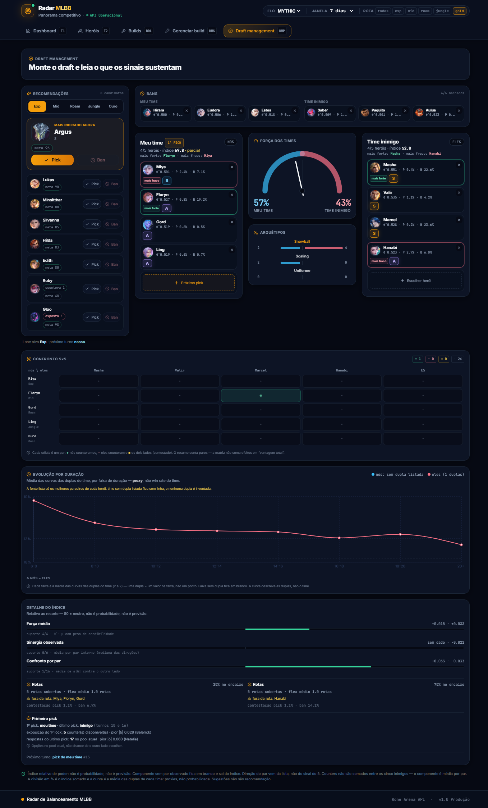
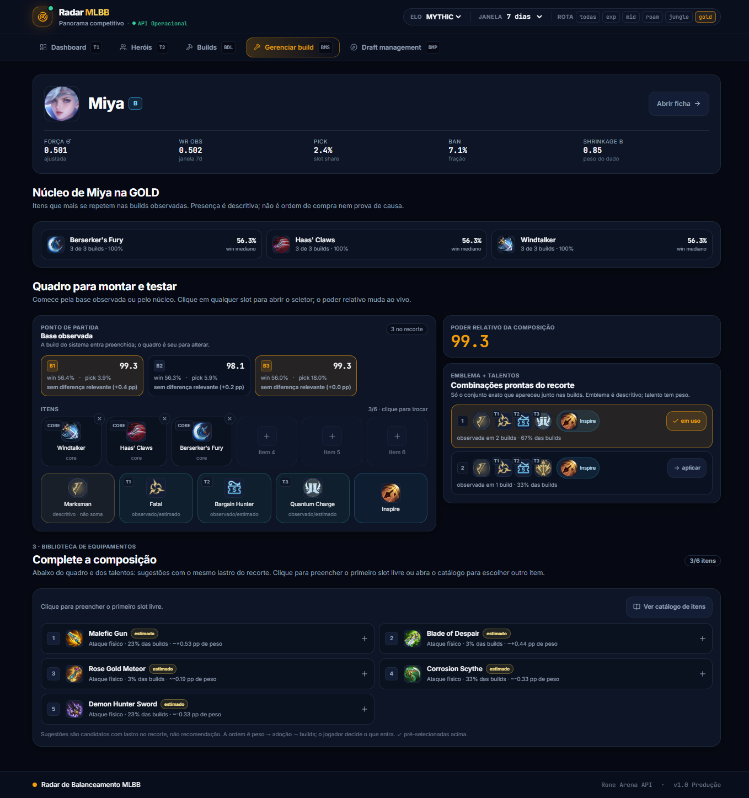

<p align="center">
  
</p>

<h1 align="center">Radar de Balanceamento MLBB</h1>

<p align="center">
  <em>Transforma a Rone Arena API em um radar de balanceamento: uma leitura clara
  de como está o meta de Mobile Legends: Bang Bang, herói por herói.</em>
</p>

---

## Screenshots




---

## O que é o sistema

**O Radar é um sistema que usa a Rone Arena API.** Essa API entrega os dados brutos
de Mobile Legends: Bang Bang — win rate, pick rate, ban rate, counters, sinergias e
builds. O Radar pega esses números e os transforma em uma **leitura clara de como
está o meta, herói por herói**.

Para cada herói, o Radar mostra:

- **o quão forte ele é de verdade**, descontando o efeito do acaso;
- **quanta evidência existe** por trás desse número;
- **para onde a tendência aponta**: subindo, caindo ou estável;
- **quais pares de heróis ajudam ou atrapalham**.

Tudo isso responde à pergunta que a maioria dos sites de estatística ignora:

> **"Esse número é sinal de que o herói é bom, ou é só sorte de uma amostra pequena?"**

Em vez de despejar uma tabela de win rate, o Radar mostra a força de cada herói
**junto com o nível de evidência** por trás dela. Quando os dados não sustentam uma
conclusão, ele diz isso claramente, em vez de inventar uma certeza.

> **O Radar não é previsão de partida, não é recomendação de pick e não é
> probabilidade de vitória.** Ele lê o passado observado; não adivinha o futuro.

---

## Para quem é

- **Jogadores** que querem entender o meta sem cair em estatística enganosa.
- **Criadores de conteúdo e analistas** que precisam de números com lastro para
  falar de balanceamento.
- **Quem monta drafts e builds** e quer saber quais escolhas são seguras e quais
  são arriscadas.

Não precisa saber estatística para usar. O sistema traduz tudo em rótulos simples
como *Forte*, *Fraco*, *Joia* ou *Amostra pequena*.

---

## O problema dos outros sistemas

Imagine dois heróis:

| Herói | Partidas observadas | Win rate |
|---|---|---|
| A | 20 | 70% |
| B | 20.000 | 54% |

Qual é mais forte? Num painel comum, o **A** parece imbatível — ele lidera a tabela.
Mas com apenas 20 partidas, aquele 70% pode ser só sorte. Já o **B** tem uma
vantagem pequena, porém muito bem comprovada.

Os sites de estatística tradicionais mostram o win rate **cru** e nada mais. Não
dizem quanta partida sustenta o número, não dizem se a diferença é sinal ou ruído,
e não avisam quando o dado é fraco demais para concluir qualquer coisa. O resultado
é um ranking que premia amostras pequenas e esconde a incerteza.

O Radar corrige exatamente esse ponto. Quando há pouca informação, o número é
**puxado para a média** (ele "encolhe"); quando há muita informação, o número
**fala por si**. O resultado é a **força ajustada** — um valor mais realista do que
o win rate cru.

---

## Como pensar nos números

### Força ajustada
É o win rate depois de descontar o efeito do acaso. Quanto menos partidas, mais o
número se aproxima da média. Assim, um herói não parece "quebrado" só porque ganhou
três partidas seguidas.

### Selos de evidência
Todo número vem com um selo dizendo o quanto ele merece confiança. Você nunca
precisa adivinhar se um valor é sólido ou apenas uma pista.

| Selo | Significa |
|---|---|
| **Validado** | Número consolidado, com base estatística firme. |
| **Descritivo** | Descreve o que foi observado, sem afirmar causa. |
| **Proposta** | Método novo, ainda em avaliação. |
| **Proxy** | Uma aproximação: serve de pista, mas não é a medida exata. |
| **Provisório** | Há indício, mas ainda falta dado para cravar. |
| **Inconclusivo** | Os dados não permitem concluir nada. |
| **Sem dado** | Não há informação suficiente neste recorte. |

### Classificação dos heróis
Cada herói recebe um rótulo simples:

- **Forte** — desempenho acima da média, com evidência.
- **Fraco** — desempenho abaixo da média, com evidência.
- **Na média** — nada fora do esperado.
- **Joia** — forte, mas pouco jogado e pouco banido: o tipo de herói que o meta
  ainda não descobriu.
- **Amostra pequena** — poucos dados; desconfie de picos.

### Confrontos nunca são "somados"
O efeito de um herói contra outro (quem *counteia* quem) é tratado **par a par**. O
Radar não soma cinco inimigos num "score mágico de draft", porque isso criaria uma
precisão que os dados não têm.

---

## O que o Radar faz

O sistema é organizado em **seis módulos**. Cada um responde uma pergunta:

| Módulo | A pergunta que responde | Confiança |
|---|---|---|
| **Exposição** | Quanto cada herói aparece nos dados? | Validado |
| **Força e Shrinkage** | Quão forte o herói é *de verdade*? | Validado |
| **Confrontos e Sinergias** | Quais pares de heróis se ajudam ou se atrapalham? | Descritivo |
| **Distorção de Draft** | A quantidade de picks e bans acompanha a força real do herói? | Proposta |
| **Blind Pick** | Dá para escolher esse herói sem ver o time inimigo? | Proxy |
| **Builds e Lift** | Qual build rende mais — e comparada a quê? | Camada A |

### Detalhando cada um

**Exposição.** Mostra o quanto o sistema enxerga de cada herói. É a base de tudo:
sem saber quanta informação existe, não dá para saber quanto confiar.

**Força e Shrinkage.** O coração do Radar. Calcula a força ajustada de cada herói e
a incerteza em volta dela.

**Confrontos e Sinergias.** Mostra quem é bom contra quem e quais duplas funcionam
bem juntas. Counters e sinergias aparecem sempre com a ressalva de quanto dado há
por trás.

**Distorção de Draft.** Compara popularidade e força. Há heróis muito escolhidos e
banidos que não são tão fortes assim? E heróis fortes que ninguém toca? Este módulo
aponta essas distorções.

**Blind Pick.** Avalia o "pior cenário razoável" de um herói quando você é obrigado
a escolher primeiro. O resultado vira um destes veredictos:

- *Blind Pick Seguro*
- *Seguro, mas Situacional*
- *Counterável*
- *Segurança Inconclusiva*

**Builds e Lift.** Compara builds de itens, talentos e runas. O "lift" mede o quanto
uma build ganha a mais (ou a menos) que uma build de referência, como a mais usada.
Sempre dentro de cada rota.

---

## O que você encontra em cada tela

Todas as telas respeitam três filtros globais, que ficam no topo e permanecem na URL
(dá para compartilhar o link exato do que você está vendo):

- **Elo** — o nível de ranqueada analisado.
- **Janela** — o período de tempo.
- **Rota** — a lane (para as telas de builds).

| Tela | Para que serve |
|---|---|
| **Panorama** (`/dashboard`) | Visão geral do meta: o que está forte, fraco e em ascensão. |
| **Heróis** (`/hero`) | Lista completa, com ordenação e paginação. Encontre qualquer herói rápido. |
| **Ficha do herói** (`/hero/:id`) | Tudo sobre um herói, em quatro abas: **Visão geral**, **Confrontos**, **Draft** e **Builds**. |
| **Draft** (`/draft`) | Ajuda a pensar composições de equipe e o poder do conjunto. |
| **Builds** (`/builds`) | Visão geral das builds no sistema inteiro e por herói. |
| **Gerenciar build** (`/build`) | Monte e compare builds: núcleo de itens, variações e slots. |

### Joias escondidas
Uma das funções mais úteis: o Radar procura heróis **fortes, mas pouco escolhidos e
pouco banidos**. Eles aparecem como *Joia* — um bom ponto de partida para quem quer
surpreender no draft.

### Tendências
Na ficha de cada herói há uma série dos últimos 30 dias (com média móvel), para ver
se ele está subindo, caindo ou estável.

---

## O que o Radar **não** faz

O Radar prefere ser honesto a parecer impressionante. Por isso, ele deliberadamente
**não**:

- **prevê o resultado de partidas**;
- **recomenda picks** ("escolha esse herói");
- **calcula chance de vitória** de uma partida específica;
- **afirma causa e efeito** (ex.: "essa build *faz* o herói ganhar").

E avisa quando não consegue saber algo. A fonte de dados não oferece, por exemplo:

- contagem exata de partidas;
- o draft completo de cada jogo;
- dados por partida individual.

Esses limites ficam visíveis dentro do próprio sistema, na página de status
(`/v1/meta/status`). Além disso, janelas de tempo que se sobrepõem **não** contam
como confirmações independentes uma da outra.

---

## Instruções básicas — como rodar

Você precisa do **Node.js 24**.

```bash
npm install     # instala o projeto
npm run dev     # abre em http://localhost:5173
```

Para uso em produção:

```bash
npm run build   # prepara tudo
npm start       # sobe em http://localhost:3001
```

> **Computador com pouca memória (4 GB)?** O `npm install` completo pode travar.
> Neste caso, use o instalador leve:
> `powershell -ExecutionPolicy Bypass -File tools\bootstrap-web.ps1`.

O sistema não tem login nem contas de usuário — não há nada para configurar antes
de usar.

---

## De onde vêm os dados

Todos os dados vêm da **Rone Arena API**. O Radar não inventa nem coleta nada por
conta própria: ele só transforma o que a API oferece em leitura de balanceamento.
Para isso, ele:

1. Busca os dados por elo e janela de tempo.
2. Guarda o resultado num cache temporário, renovado a cada **2, 6 ou 24 horas**
   dependendo do tipo de dado — isso deixa as telas rápidas e evita sobrecarregar a
   fonte.
3. Calcula tudo a partir daí.

O cache pode ser apagado a qualquer momento sem perder nada: ele é só uma cópia
reconstruível, não a fonte da verdade.

---

## Créditos — Rone Arena API

Este projeto **não existiria sem a Rone Arena API**, uma API REST **não oficial e
mantida pela comunidade** para Mobile Legends: Bang Bang, criada por
[ridwaanhall](https://github.com/ridwaanhall/rone-arena-api).

- **Site e playground:** <https://arena.rone.dev/>
- **Repositório:** <https://github.com/ridwaanhall/rone-arena-api>
- **Documentação (OpenAPI):** <https://arena.rone.dev/api/openapi.json>

Todo o crédito pelos dados é da Rone Arena. O Radar de Balanceamento é apenas um
consumidor: não coleta, não hospeda e não redistribui os dados brutos — só oferece
uma leitura sobre eles.

> A Rone Arena API é **não oficial** e **não tem afiliação com a Moonton**. Mobile
> Legends: Bang Bang é marca da Moonton; o nome é usado apenas para descrever os
> dados. Este projeto também não tem vínculo com a Rone Arena.

---

## Para quem quer ir mais fundo

Esta página é uma visão geral, em linguagem simples. Os detalhes técnicos ficam em:

- **Decisões de arquitetura (ADRs):** `AGENTS/artefatos/architecture/`. Comece pela
  `ADR-033`.
- **Especificações de tela e UX:** `AGENTS/artefatos/spec/` e `AGENTS/artefatos/ux/`.
- **Regras de cálculo e evidência:** os comentários de módulo em
  `packages/engine/src/`.
- **Rotas da API e variáveis de configuração:** o arquivo
  `app/api/src/infra/config.js`.

Resumo da estrutura, para se orientar:

| Pasta | O que tem |
|---|---|
| `app/web` | A interface (o que você vê no navegador). |
| `app/api` | O servidor que busca e entrega os dados. |
| `packages/engine` | O "cérebro": toda a matemática e estatística. |
| `packages/contracts` | O formato combinado dos dados entre servidor e interface. |
| `tools` | Ferramentas de verificação e instalação. |

---

## Licença

Projeto privado, sem licença pública declarada.
